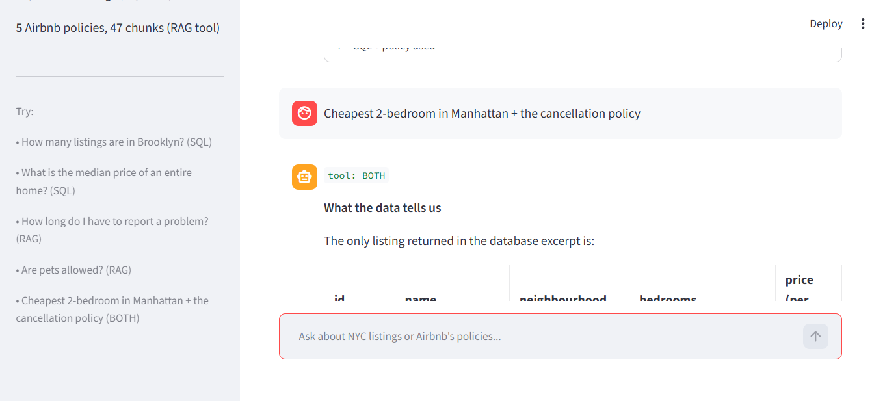

# Airbnb Agent

One assistant, three tools. Ask a question and it decides whether it needs the
listings database (SQL), Airbnb's policies (RAG), or both.

**Live demo:** (https://airbnb-agent-v1.streamlit.app)

**Measured:** 100% routing accuracy and 100% answer accuracy on a
[16-question golden set](airbnb_golden_set.json) (`python evaluate_airbnb.py`).

## What it does

- 29,918 real NYC listings scraped from Inside Airbnb — price, room type,
  bedrooms, neighbourhood, availability, reviews, estimated revenue
- 5 real Airbnb policies (cancellation, refunds, house rules), chunked and
  indexed for semantic search
- A router that picks SQL, RAG or BOTH per question, and shows you which it chose

## Examples

- "How many listings are in Brooklyn?"                       -> SQL
- "Which borough has the highest median price?"              -> SQL
- "How long do I have to report a problem?"                  -> RAG
- "Find the cheapest 2-bedroom in Manhattan and tell me the
   cancellation policy"                                      -> BOTH

## How it works

question -> router (SQL / RAG / BOTH / chat) -> tool runs -> grounded answer

- **SQL tool**: the schema (with null-rates AND the actual stored values of key
  columns) goes to the LLM, which writes a query.
- **RAG tool**: policies are split into 47 chunks; the question is embedded and
  matched by cosine similarity.
- **BOTH**: unlike a typical agent, the two sources are INDEPENDENT here — the
  listings and the policies are separate corpora, so both are run and combined.

## Tech

Python, Streamlit, SQLite, fastembed, Groq

## Known data issues

- `price` is missing for about a third of listings — every price query filters
  `price IS NOT NULL`.
- The database holds listing data only. Policies live in a separate RAG corpus;
  the router must not try to select policy columns.
- Listings are a single snapshot (September 2026), not a live feed.
- A listing's `name` can disagree with its `bedrooms` column (one listing is
  named "1 BR" but has bedrooms = 2).

## Note on data

Listings: Inside Airbnb (insideairbnb.com), CC BY 4.0.
Policies: Airbnb Help Center (airbnb.com/help). Used for educational purposes;
all rights belong to Airbnb.
